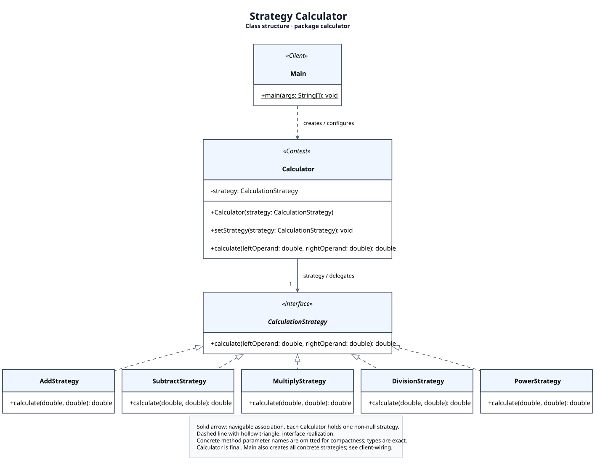

# Strategy Calculator

A Java calculator with interchangeable addition, subtraction, multiplication,
division, and power strategies. The same `Calculator` switches operations at runtime.

## Run in VS Code

1. Open the **project folder** containing `pom.xml` in VS Code.
2. Install **Extension Pack for Java** if needed. It includes Test Runner for Java.
3. Let Java finish importing the Maven project and downloading JUnit dependencies.
4. Open **Testing** in the activity bar and choose **Run All Tests**, or use the
   run button next to a test method. Open `src/main/java/calculator/Main.java`
   and use **Run Java** above `main` to run the demo.

If this folder was already open before `pom.xml` was added, run
**Java: Import Java Projects into Workspace** from the command palette and wait
for Maven import to finish. A package error expecting `src.main.java.calculator`
means VS Code is still treating the folder as an unmanaged Java project.
Do not change the package declaration to match that incorrect source root.

JUnit 5 comes from `pom.xml`; manually adding JUnit 4 JARs to `lib` is unnecessary
and does not provide the `org.junit.jupiter` classes used by these tests.

If VS Code still shows the old files or unresolved imports after import, run
**Java: Clean Java Language Server Workspace** from the command palette and
allow it to restart. Tests need the Java language server in **Standard** mode.

JUnit discovery and Maven dependency setup follow the
[official VS Code Java testing guide](https://code.visualstudio.com/docs/java/java-testing).

## Run on another computer

Clone the repository, install JDK 17 or newer, and set `JAVA_HOME` to that JDK.
Run the wrapper commands above from the repository root. The first build needs
internet access; Maven and JUnit do not need to be installed manually.

Commit `src/`, `pom.xml`, both wrapper scripts, the hidden `.mvn/` directory,
`.gitattributes`, `.gitignore`, `.vscode/extensions.json`, and the documentation.
Build output (`target/`, `out/`), local tool caches (`.maven/`), and manually
downloaded JUnit 4 JARs (`lib/`) are ignored and are not needed on another PC.

## UML



The [UML documentation](docs/uml/README.md) contains editable PlantUML sources,
SVG/PNG exports, and a separate view of construction dependencies from `Main`.
The two views keep the classes aligned and avoid crossed relationship lines.

## Structure

```text
src/main/java/calculator/        Application classes in package calculator
src/test/java/calculator/tests/  JUnit tests with explicit application imports
pom.xml                         Java 17, JUnit 5, compiler and test runner
mvnw, mvnw.cmd, .mvn/            Standard Maven Wrapper
CLEAN_CODE.md                   Five justified examples from Chapters 9–11
docs/uml/                       PlantUML sources and rendered diagrams
```

`CalculationStrategy` is the interface; each concrete strategy implements one
algorithm. `Calculator` stores the interface and delegates execution. `Main`
constructs the objects, chooses strategies, and prints results.

## Tests

Two test classes contain five test methods, producing **10 test cases**:

- Five parameterized cases check the existing algorithms, including fractional division.
- One test switches strategies and switches back on the same calculator.
- One supplies a new remainder strategy, without changing production classes.
- One rejects a null replacement and verifies that the current strategy is preserved.
- Two parameterized cases reject positive and negative zero divisors.

JUnit assertions determine success or failure automatically. No `main`, custom
assertion helper, or `-ea` flag is needed in the tests.

See [Clean Code examples](CLEAN_CODE.md) for annotated excerpts and explanations
of how these choices relate to Chapters 9, 10, and 11.
