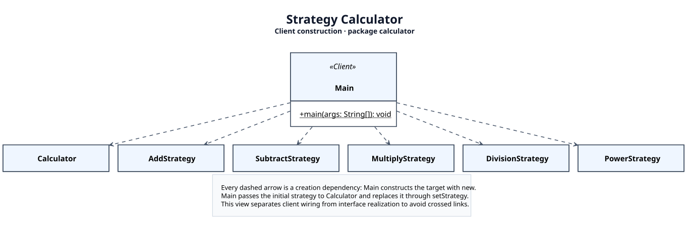

# UML diagrams

These are UML class diagrams authored in PlantUML, not generated illustrations.
All eight production types from `src/main/java/calculator` are represented.
JUnit test classes and library types are outside the scope of these design views.

## Class structure


[PlantUML source](strategy-pattern.puml) · [SVG](strategy-pattern.svg) · [PNG](strategy-pattern.png)

The client, context, and strategy interface form the central column. All five
concrete strategies occupy an ordered row. The context has a navigable association
to exactly one strategy; implementations use dashed realization arrows with hollow
triangles. No composition diamond is used: strategies are supplied by the client
and do not share the context's lifecycle. `Calculator` is final, as noted in the legend.

## Client construction



[PlantUML source](client-wiring.puml) · [SVG](client-wiring.svg) · [PNG](client-wiring.png)

This complementary view shows every object construction dependency from `Main`.
Separating these dependencies from interface realization keeps unrelated arrows
from crossing. It does not add classes, packages, or relationships to the design.
The context link also appears in the structural view to make the client's role clear.

## Rebuild the images

The committed SVG and PNG files can be viewed without installing a UML tool.
Rendering is optional and independent of the application build.

Use **PlantUML 1.2025.2** for the checked layout. Obtain the JAR from
[Maven Central](https://repo.maven.apache.org/maven2/net/sourceforge/plantuml/plantuml/1.2025.2/plantuml-1.2025.2.jar)
or the [PlantUML project](https://plantuml.com/download).

From the repository root in PowerShell, with `JAVA_HOME` pointing to your JDK:

```powershell
.\docs\uml\render.ps1 -PlantUmlJar C:\tools\plantuml-1.2025.2.jar -JavaExecutable "$env:JAVA_HOME\bin\java.exe"
```

The JAR location is an example; use the location where you downloaded it.
Alternatively, on any platform with Java on PATH:

```text
java -jar /path/to/plantuml-1.2025.2.jar -charset UTF-8 -tsvg docs/uml/strategy-pattern.puml docs/uml/client-wiring.puml
java -jar /path/to/plantuml-1.2025.2.jar -charset UTF-8 -tpng docs/uml/strategy-pattern.puml docs/uml/client-wiring.puml
```

`style.puml` selects the bundled Smetana layout engine, so a separate Graphviz
installation is not needed. Hidden links fix the order of the strategy row;
`together`, spacing, and shared styles keep the classes aligned. These layout-only
links are invisible and are not UML dependencies. Font metrics can vary slightly
across operating systems; the committed images preserve the reviewed layout.

The approach follows the official [PlantUML layout documentation](https://plantuml.com/layout-engines).
